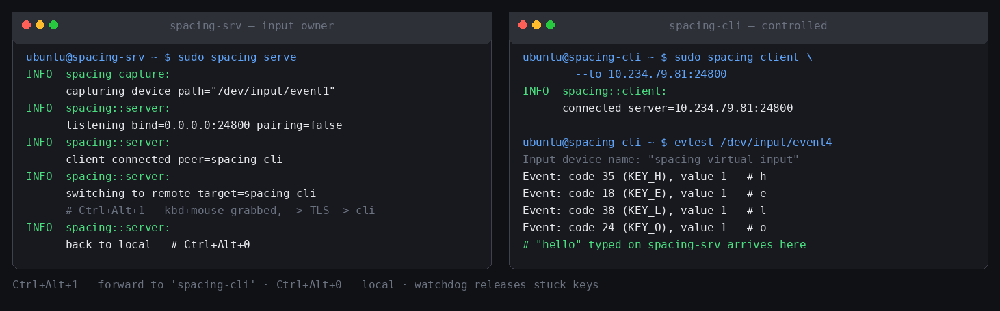
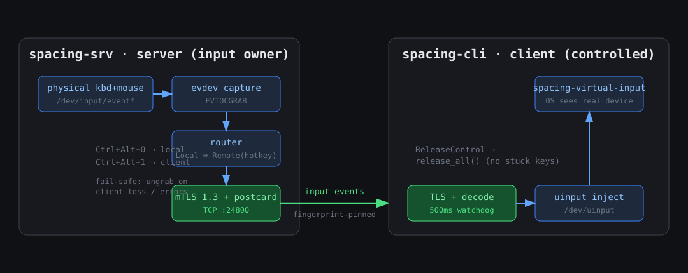
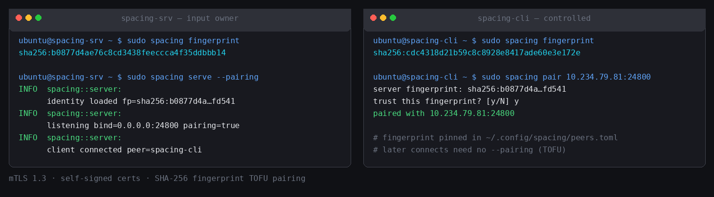

# spacing

**LAN software KVM in Rust** — share one keyboard and mouse between computers
on the same network. Input only: **no** remote desktop, video, or audio.

Press a hotkey on the machine that owns the keyboard, and your keystrokes
start landing on the other computer — as if the keyboard were plugged into it.

```
Ctrl+Alt+1 → your input goes to "laptop"
Ctrl+Alt+0 → your input comes back local
```



## Status

| Platform | Capture | Inject | Status |
|---|---|---|---|
| Linux (X11 / Wayland / TTY) | evdev | uinput | **supported** |
| Linux Wayland (portal-native) | InputCapture portal → libei | RemoteDesktop portal → libei | **supported** (GNOME 45+/KDE 6.1+) |
| Windows | `WH_KEYBOARD_LL`/`WH_MOUSE_LL` hooks | `SendInput` (scan codes) | implemented — compiles, needs on-device smoke test |
| macOS | `CGEventTap` | `CGEventPost` | implemented — compiles, needs on-device smoke test |

Backends per platform:

- **`evdev`** (Linux) — kernel-level, works on X11, Wayland, and
  headless/TTY; needs `/dev/input` + `/dev/uinput` access. Switch by hotkey.
- **`portal`** (Linux) — XDG InputCapture + RemoteDesktop portals over
  libei; no udev rules needed, native Wayland. Switch by moving the
  pointer across a configured screen edge (or `Ctrl+Alt+0` back).
- **Windows hooks** — low-level keyboard/mouse hooks on a dedicated
  message-pump thread swallow events while remote and mirror them for
  edge/hotkey switching while local. Edge switching uses the
  clamped-cursor technique (consecutive outward pushes at the screen
  edge), matching Barrier/Deskflow UX.
- **macOS CGEventTap** — a session event tap on its own CFRunLoop
  thread; same edge-switch semantics as Windows.

## Features

- **Screen-edge switching** — push the pointer through a configured
  monitor edge to hand control to the mapped machine (portal barriers on
  Wayland, clamped-cursor detection on Windows/macOS)
- **Hotkey switching** between the input-owner machine and any paired client
- **Text clipboard sync** — copies follow your input, up to 1 MiB, both ways
- **Mutual TLS 1.3** — every keystroke encrypted on the wire
- **TOFU pairing** — SHA-256 fingerprint verify once, pinned to `peers.toml`
- **Fail-safe by design** — client loss ungrabs instantly; a 500 ms watchdog
  releases held keys; the input owner never loses its keyboard
- **Light** — ~5 MB RSS, <1 % CPU at ~1000 input events/s, ~0.7 ms median
  end-to-end LAN latency ([benchmark report](docs/benchmarks/2026-11-02-p1-latency.md))
- Single static binary, daemon-style, TOML config



## Install

### Prebuilt binary (Linux x86_64)

Download `spacing-x86_64-linux.tar.gz` from
[Releases](https://github.com/enolalab/spacing/releases) — statically linked,
runs on any glibc/musl distro:

```sh
tar xzf spacing-x86_64-linux.tar.gz
sudo install -m755 spacing /usr/local/bin/
sha256sum -c checksums.txt   # verify against release checksums
```

### Build from source

Rust 1.85+ (`rust-toolchain.toml` pins the toolchain):

```sh
git clone https://github.com/enolalab/spacing
cd spacing
cargo build --release --bin spacing
sudo install -m755 target/release/spacing /usr/local/bin/
```

Portable static build (any Linux): `./contrib/build-static.sh` →
`target/x86_64-unknown-linux-gnu/release/spacing`.

### Permissions (required, both machines)

**Windows:** none for a regular desktop session — `WH_*_LL` hooks and
`SendInput` are user-level APIs. Note: input from/to *elevated* apps is
ignored unless spacing itself runs elevated (UIPI).

**macOS:** two TCC grants in *System Settings → Privacy & Security*:
- **Input Monitoring** — required for the `CGEventTap` capture
  (server side). spacing fails to start with a hint if missing.
- **Accessibility** — required for `CGEventPost` injection
  (client side).
Grant to the terminal app (or the installed `spacing` binary), then
restart spacing once.

**Portal backend (Wayland, GNOME 45+/KDE 6.1+):** nothing — the portal
mediates device access. GNOME shows a permission dialog per start
(server: *"Capture Input"*, client: *RemoteDesktop*); approve it once per
run — or automate it via `contrib/portal-approve.py` (AT-SPI helper for
headless/smoke testing). KDE grants InputCapture without a prompt.

**evdev backend (default on X11/headless):** spacing reads real input
devices (`/dev/input/event*`) and creates a virtual device (`/dev/uinput`):

```sh
sudo cp contrib/99-spacing.rules /etc/udev/rules.d/
sudo udevadm control --reload && sudo udevadm trigger
sudo usermod -aG input $USER    # log out/in afterwards
```

(Or run via `sudo` — it's what the screenshots do.)

## Quick start

**1. Input-owner machine** (has the physical keyboard/mouse):

```sh
spacing fingerprint            # note this fp
spacing serve --pairing        # one-shot pairing window
```

**2. Controlled machine** — pair once (TOFU):

```sh
spacing pair <server-ip>:24800
# server fingerprint: sha256:…   ← compare with step 1, type `y`
```



**3. Run it:**

```sh
# input-owner:
spacing serve                  # pairing flag no longer needed

# controlled machine:
spacing client --to <server-ip>:24800
```

**4. Switch control** with hotkeys configured on the server:

```toml
# ~/.config/spacing/config.toml on the INPUT-OWNER machine
mode = "server"
bind = "0.0.0.0:24800"
backend = "auto"                # auto|evdev|portal — portal on capable Wayland

[server.hotkeys]
local = "Ctrl+Alt+0"            # return input to this machine
"Ctrl+Alt+1" = "laptop"         # → forward to client whose hostname is "laptop"
"Ctrl+Alt+2" = "desktop"        # → another client

# Portal backend only: pointer pushed through this edge switches control
[server.layout.edges]
right = "laptop"
left  = "desktop"
```

The hotkey/edge target is the client's **hostname** — the value `hostname`
prints on the controlled machine (sent in its `Hello`). Valid edge names:
`left`, `right`, `top`, `bottom`.

Client-side config is optional (`--to` is enough):

```toml
mode = "client"
connect_to = "192.168.1.5:24800"
backend = "auto"                # same selection as the server
```

On the portal backend the client machine shows a **RemoteDesktop dialog**
on each connect — approve it to allow input injection (toggle "Allow
Remote Interaction", then *Share*; `contrib/portal-approve.py` does this
automatically via AT-SPI).

## Security model

- Self-signed ECDSA P-256 identity certs generated per machine
  (`~/.config/spacing/`), TLS 1.3 mutual auth both directions.
- First contact is a one-shot pairing window: the client shows the server's
  SHA-256 fingerprint; accepting pins both fingerprints to `peers.toml`.
  Reconnects must match the pin — MITM swapped certs are rejected.
- Frames are length-prefixed postcard (max 2 MiB); malformed input drops the
  connection and returns control locally.
- **Keystrokes are never logged.** All traffic is inside TLS.
- `SPACING_WIRE_DUMP=<file>` exists for transport debugging — it records
  frame bytes (i.e. keys) and is off unless explicitly set.

## Performance

Measured on two Ubuntu 24.04 VMs (full methodology and raw data in the
[report](docs/benchmarks/2026-11-02-p1-latency.md)):

| Workload | Median latency | p99 | Loss |
|---|---|---|---|
| Keys, ~940 ev/s sustained (LAN + TLS) | 0.69 ms | 1.45 ms | 0/4000 |
| Mouse, ~195 ev/s (LAN + TLS) | 0.68 ms | 1.45 ms | 0/500 |
| Loopback pipeline baseline | 0.26 ms | 0.65 ms | 0/4000 |

## Known limitations

- **Hotplug:** devices plugged in *after* `serve` starts are not captured
  (enumeration happens once at startup). Restart `serve` after plugging in
  new hardware. (evdev backend only)
- **Portal backend:** barriers span the whole screen edge — per-monitor
  sub-segments and zone-change hot-reload are not implemented yet.
  RemoteDesktop prompts once per session start (restore tokens not wired).
  Switching *away* from a remote uses `Ctrl+Alt+0`, not a reverse edge.
- **Switch while holding modifiers:** pressing the switch combo while
  Ctrl/Alt is logically held can leave that modifier "stuck" on the server —
  press+release it once to clear.
- IPv4/hostnames only in `host:port` (no `[v6]:port` parsing yet).
- Media/consumer keys (volume etc.) are dropped at capture.
- Clipboard is text-only, 1 MiB cap, polled (300 ms).
- Remote→remote switching is implemented but lightly tested (needs 3 machines).

## Roadmap

- ~~**P2** — Wayland-native path: XDG InputCapture portal + libei inject,
  edge/barrier switching, text clipboard (≤1 MiB)~~ **done**
- ~~**P3** — Windows backend (`WH_*_LL` hooks + `SendInput` scan codes,
  clamped-cursor edge switching)~~ — implemented, pending device testing
- ~~**P4** — macOS backend (`CGEventTap` + `CGEventPost`,
  Input Monitoring/Accessibility permissions)~~ — implemented, pending
  device testing
- **P5** — edge-switch for evdev path, auto-reconnect, mDNS discovery,
  systemd units, hotplug support, RemoteDesktop restore tokens

Design spec and P1 plan: [`docs/superpowers/specs/`](docs/superpowers/specs/).

## Development

```sh
cargo test --workspace        # 47 tests incl. TLS loopback + libei wire tests
cargo clippy --workspace
```

`src/bin/e2e.rs` is a dev tool that creates virtual evdev devices to test the
pipeline without a real keyboard:

```sh
cargo build --release --bin e2e
e2e emit 5                # virtual kbd: Ctrl+Alt+1, "hello", Ctrl+Alt+0
e2e emit-bench 5 2000 2 key   # benchmark emitter (see docs/benchmarks/)
e2e listen --ts <name>    # dump evdev events with timestamps
```

## License

[MIT](LICENSE) © enolalab
