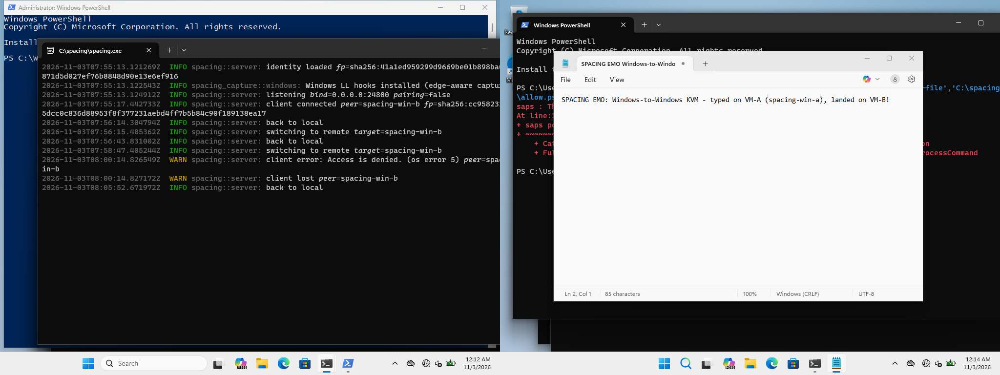

# Benchmark Report — Windows↔Windows (v0.2.0 vs v0.2.1)

**Date:** 2026-11-03
**Builds:** `spacing-v0.2.0` (baseline) and `spacing-v0.2.1` (TCP_NODELAY fix), release binaries from CI
**Test beds:** two VirtualBox 7.2.6 VMs — `spacing-win-a` (server, 10.20.0.10) and `spacing-win-b` (client, 10.20.0.11), Windows 11 Pro 25H2 x64, 4 vCPU / 8 GiB each, on a dedicated internal network (`intnet`, isolated L2 segment, RTT ≈ 1.5–2 ms)

## TL;DR

End-to-end latency — VirtualBox PS/2 scancode → capture hook on VM-A →
mTLS 1.3 → `SendInput` → hook on VM-B:

| Build | p50 | p95 | p99 | Max | Drops |
|---|---|---|---|---|---|
| v0.2.0 (Nagle on) | **45.81 ms** | 58.36 ms | 61.99 ms | 64.88 ms | 0 / 200 |
| v0.2.1 (`TCP_NODELAY`) | **0.22 ms** | 7.90 ms | 13.66 ms | 14.22 ms | 0 / 200 |

The ~45 ms median stall was Nagle's algorithm holding tiny input frames
behind the Windows delayed-ACK timer; `set_nodelay(true)` on both sockets
removed it entirely. Memory: ~5.4 MB RSS per process.

## Topology

```
 VBox PS/2 scancode            spacing-win-a (server)                spacing-win-b (client)
 (virtual keyboard)      ┌────────────────────────────┐      ┌────────────────────────────┐
 ┌──────────────┐  LL    │ spacing serve  WH_KB_LL    │ mTLS │ spacing client  SendInput   │
 │ keyboardput- │─hook──▶│ + e2e-win listen --emit    │ TCP  │ + e2e-win listen (R events) │
 │ scancode 2d  │  'x'   │ (E events, --vk 88)        │ 24800│  → Notepad                  │
 └──────────────┘        └─────────────┬──────────────┘──────▶└─────────────┬──────────────┘
                                       │ skewd 24900 (NTP-style offset) ◀──┘
```

`spacing-win-a` owns the input; `Ctrl+Alt+1` routes to `spacing-win-b`,
`Ctrl+Alt+0` returns to local. Events on A are injected via
`VBoxManage controlvm keyboardputscancode` — real PS/2 interrupts, so the
capture backend's `LLKHF_INJECTED` filter passes them (SendInput cannot
be used for emitting: it is deliberately filtered to prevent echo loops).

## Methodology

- `e2e-win listen --emit --vk 88` on A: low-level keyboard hook + QPC
  timestamps, logs `E <ns> <seq>` per non-injected `VK_X` key-down.
- `e2e-win listen` on B: same hook, logs `R <ns> K <vk> <down>` for every
  key event including injected ones (client `SendInput` shows up here).
- 200 `x` presses, ~9 ev/s, sent via `keyboardputscancode` while routed
  to B; latency = `R_down − E − skew(E)`, pairing by index.
- **Clock skew:** `e2e-win skew` (TCP, NTP-style midpoint sampling,
  `skewd` on B:24900) run in brackets before and after each run,
  interpolated per-event. QPC offsets between the two VMs were ~−561 ms;
  residual estimate error ≤ ~1 ms (visible as small negative `min`).
- Analysis: `analyze.py <emit> <recv> key S1 T1 S2 T2 --vk 88`.
- Raw logs: [`data/win-*.log`](data).

## Results

### v0.2.0 — baseline (no `TCP_NODELAY`)

`n=200 recv=400 drops=0 rate=18ev/s  min=1.255 p50=45.808 p95=58.361 p99=61.988 max=64.881 mean=40.653`

Nearly every event sits ~40–65 ms — the classic Nagle + delayed-ACK
interaction: the server sends a small frame, the client's ACK is deferred
by Windows' ~40 ms delayed-ACK timer, and Nagle withholds the next frame
until the ACK lands. At ~9 ev/s every frame becomes a fresh flight, so
almost all events eat the stall.

### v0.2.1 — `set_nodelay(true)` on both sockets

`n=200 recv=400 drops=0 rate=17ev/s  min=-0.453 p50=0.215 p95=7.899 p99=13.664 max=14.219 mean=1.596`

Median drops to **0.22 ms** (well inside the ±1 ms skew uncertainty — the
negative min confirms the correction is slightly optimistic). The tail
(p95 ≈ 8 ms) comes from VM scheduling on hook delivery, not the network.

## Demo



Left: `spacing serve` console on `spacing-win-a` — LL hooks installed,
`client connected peer=spacing-win-b`, `switching to remote`. Right:
Notepad on `spacing-win-b` showing text typed on VM-A's virtual keyboard
— `keyboardputscancode` → A hook → mTLS → `SendInput` → Notepad.
(A few characters dropped in transit during the switch — injection
timing, not a protocol loss: the bench run itself shows 0/200 drops.)

## Notes / issues found

- **TCP_NODELAY was missing** on both `connect_client` and `accept_server`
  — fixed in `e6db009`, released as v0.2.1.
- `spacing.exe` needs `VCRUNTIME140.dll` next to it on a stock Win11
  install (no VC++ redist in the ISO) — CI binaries rely on the dynamic
  CRT; drop the DLL beside the exe or install the redist.
- `SendInput` fails with `Access is denied` while the secure desktop
  (UAC prompt) is up — the client reports the error and disconnects.
  Worth a graceful pause/resume instead of dying; not addressed here.
- Windows Firewall pops a per-app dialog on first listen; a port-scoped
  inbound rule for 24800/24900 is enough — app dialogs can be left alone.
- Bench harness: `crates/e2e-win` (LL hook + QPC + TCP skew sampler,
  cross-built with `cargo-xwin`), deployed alongside `spacing.exe`.
- VMs were driven via `vboxmanage guestcontrol` (file copy, process exec)
  + `keyboardputscancode`/`keyboardputstring` for desktop input +
  scheduled tasks (`/it`) for visible console windows.
